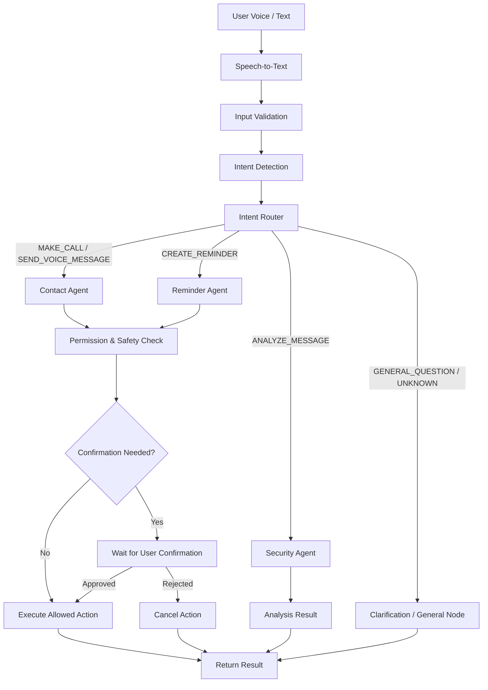

# YAXIN AI — AI Agent Workflow

YAXIN AI LangGraph əsasında idarə olunan, çoxmərhələli **Agentic Workflow** arxitekturasından istifadə edir.

## 1. Workflow Diagram

## 2. Core Intents

- `MAKE_CALL` — Kontakt tapmaq və zəng başlatmaq (*"Qızıma zəng et"*, *"Anama zəng vur"*)
- `CREATE_REMINDER` — Xatırlatma yaratmaq (*"Sabah saat 9-da məni oyat"*, *"Axşam saat 8-də dərmanımı xatırlat"*)
- `ANALYZE_MESSAGE` — Şübhəli SMS və ya mesajı yoxlamaq (*"Bu mesaj təhlükəlidir?"*, *"Bank hesabınız bloklanıb..."*)
- `SEND_VOICE_MESSAGE` — Kontakt üçün səsli mesaj əməliyyatı hazırlamaq (*"Anama səs göndərmək istəyirəm"*)
- `GENERAL_QUESTION` — Sadə məlumat xarakterli suallar (*"Sabah hava necə olacaq?"*, *"Sən nə edə bilirsən?"*)
- `UNKNOWN` — Aydın olmayan və ya dəstəklənməyən müraciətlər (dəqiqləşdirmə tələb edir)

## 3. LangGraph Nodes

| Node | Vəzifə |
|---|---|
| `input_node` | İstifadəçi mesajını normallaşdırır və yoxlayır |
| `intent_node` | LLM adapter və ya qayda əsaslı hibrid klassifikator ilə niyyəti çıxarır |
| `router_node` | Niyyətə uyğun agent qovşağını seçir |
| `contact_node` | `contact_alias` çıxarır və `CONTACT_LOOKUP` əməliyyatı hazırlayır |
| `reminder_node` | Başlıq, tarix/saat (`Asia/Baku`) çıxarır və xatırlatma strukturunu hazırlayır |
| `security_node` | Mesajdakı risk indikatorlarını (urgency, credential_request, suspicious_link və s.) yoxlayır |
| `validation_node` | İcazə və biznes qaydalarını yoxlayır (məs. bank/Wolt əməliyyatlarını bloklayır/simulyasiya edir) |
| `confirmation_node` | `requires_confirmation` tələb edən əməliyyatları təsdiq gözləmə vəziyyətinə keçirir |
| `response_node` | Azərbaycan dilində yekun cavabı formalaşdırır |

