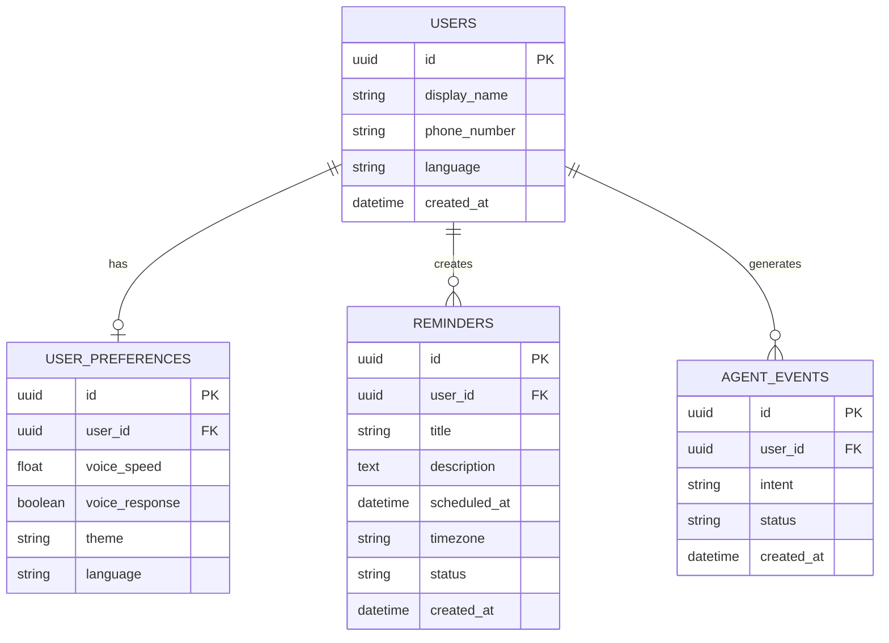

# YAXIN AI — Database Schema

YAXIN AI minimum məlumat saxlama (`Data Minimization`) prinsipi ilə işləyir. Kontakt məlumatları, tam səs yazıları və həssas mesaj məzmunları verilənlər bazasında saxlanılmır.

## 1. Entity Relationship Diagram



## 2. SQL DDL

```sql
CREATE TABLE users (
    id UUID PRIMARY KEY,
    display_name VARCHAR(100),
    phone_number VARCHAR(20),
    language VARCHAR(10) DEFAULT 'az-AZ',
    created_at TIMESTAMPTZ DEFAULT NOW()
);

CREATE TABLE user_preferences (
    id UUID PRIMARY KEY,
    user_id UUID UNIQUE REFERENCES users(id) ON DELETE CASCADE,
    voice_speed FLOAT DEFAULT 1.0,
    voice_response BOOLEAN DEFAULT TRUE,
    theme VARCHAR(20) DEFAULT 'light',
    language VARCHAR(10) DEFAULT 'az-AZ'
);

CREATE TABLE reminders (
    id UUID PRIMARY KEY,
    user_id UUID REFERENCES users(id) ON DELETE CASCADE,
    title VARCHAR(255) NOT NULL,
    description TEXT,
    scheduled_at TIMESTAMPTZ NOT NULL,
    timezone VARCHAR(50) DEFAULT 'Asia/Baku',
    status VARCHAR(20) DEFAULT 'pending',
    created_at TIMESTAMPTZ DEFAULT NOW()
);

CREATE TABLE agent_events (
    id UUID PRIMARY KEY,
    user_id UUID REFERENCES users(id),
    intent VARCHAR(100),
    status VARCHAR(30),
    created_at TIMESTAMPTZ DEFAULT NOW()
);
```

